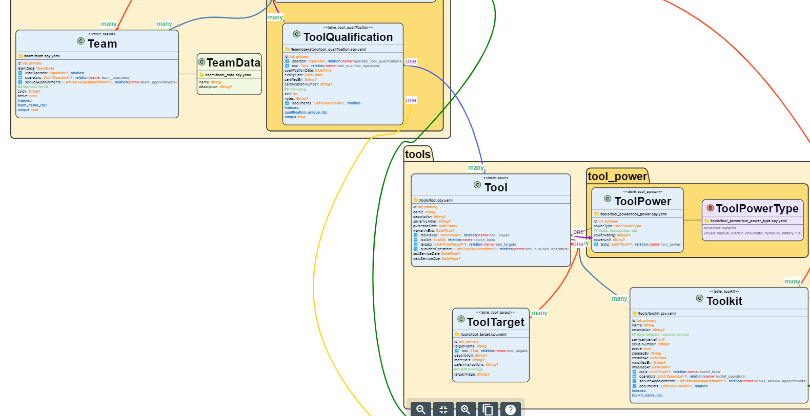

# UML for Serverpod 🗺️ 🚀

Generate PlantUML diagrams from your serverpod `.spy.yaml` model files.



## Installation

```bash
dart pub global activate uml_for_serverpod
```

Or add to your project's pubspec.yaml:

```yaml
dependencies:
  uml_generator: ^0.0.5
```

## Usage

### As a command-line tool

```bash
dart run uml_for_serverpod 
```
You can use options in the command, like:

```bash
dart run uml_for_serverpod --dir=lib/src/models --output=my_serverpod_uml_diagram.puml
```
#### CLI options

- `--dir, -d`: Directory containing .spy.yaml files (default: "lib")
- `--output, -o`: Output PlantUML file (default: "er_diagram.puml")
- `--config`: path to .yaml configuration file
- `--format, -f`: `plantuml` (default, writes a `.puml` file) or `dot` (renders an SVG with Graphviz, see [Graphviz backend](#graphviz-backend))
- `--help, -h`: Show usage information

### As a library

**Not tested!**
```dart
import 'dart:io';
import 'package:uml_for_serverpod/uml_for_serverpod.dart';

Future<void> main() async {
  final generator = UmlGenerator(
    modelsDir: Directory('lib/src/models'),
    yamlOutputFile: File('all_yaml_content.txt'),
    umlOutputFile: File('er_diagram.puml'),
    // Optional customization
    classHexColor: '#800080',
    manyHexColor: '#008000',
  );
  
  await generator.generate();
}
```

### Configuration

You can customize the UML generation by providing a YAML configuration file:

```bash
dart run uml_for_serverpod --config=uml_config.yaml
```

Example configuration file `uml_config.yaml`:

```yaml
paths:
  modelsDirPath: lib/src/models
  umlOutputFile: 'uml_diagram.puml'
options:
  printComments: true
  useNameSpace: true
  ignoreRootFolder: 'models'
layout:
  skinparamNodesep: 30
  skinparamRanksep: 100
  engine: elk # optional: elk or smetana; omit for graphviz. elk balances large diagrams
  flatPackages: true # optional: dotted package names stay flat instead of nesting
style:
  relations:
    colorfullArrows: true
    colorfullTypeLinks: true # optional: colour field-type and inheritance links too
    oneHexColor: '#9b59b6'
    oneString: 'one'
    manyHexColor: '#27ae60'
    manyString: 'many'
    relationHexColor: '#0164aa'
  class:  
    classNameHexColor: '#ff962f'
    classBackgroundHexColor: '#f1f8df'
    classBorderHexColor: '#333333'
    maxWidth: 400 # optional: class cards wrap their text beyond this width (px)
  comment:
    commentHexColor: '#93c47d'
  namespace:
    namespaceBorderHexColor: '#333333'
    rootNamespaceBackgroundHexColor: '#fff2cc'
    firstLevelNamespaceBackgroundHexColor: '#ffe9a7'
    secondLevelNamespaceBackgroundHexColor: '#ffdb72'
```
#### Paths
- `umlOutputFile`: If set, this will be the output path. If another value is set in the command line, it will override this.
- `modelsDirPath`: If set, this will be starting point for `.spy.yaml` files. If another value is set in the command line, it will override this.
#### Options
- `printComments`: If set to false, comments won't be printed
- `useNameSpace`: If set to true, the objects in the UML diagramm will be grouped in packages according to the folder structure (two levels deep). If set to false, all objects will be loose.
- `ignoreRootFolder`: If `useNameSpace` is set to true and `ignoreRootFolder` is set to the string of a folder inside `modelsDirPath`, this folder will be ignored when grouping the objects in packages.
#### Layout
- `skinparamNodesep`: If given a value, the uml style will include `skinparam nodesep` with the given value.
- `skinparamRanksep`:  If given a value, the uml style will include `skinparam ranksep` with the given value.
- `engine`, `flatPackages`: PlantUML only, see the example above.
- `grid`, `splines`: Graphviz backend only, see below.
#### Style
##### Relation
- `colorfullArrows`: If set to true, the arrows will be created in 6 different colors that are easy to tell apart. I set to false, the arrows will be black.
- `oneString`: String used to annotate the one side of a relation.
- `oneHexColor`, `oneString`: same as the many variant, but for the one side.
- `manyString`: String used to annotate the many side of a relation.
- `commentsHexColor`: The color of the comments' text.
- `manyHexColor`: color of the annotation text for the many side of a relation.

The rest are color settings and are self explanatory.

**Notice**: `skinparam` has been deprecated and styles should be migrated to the `<style>` api.

## Graphviz backend

PlantUML lays large diagrams out badly in one of two ways: Graphviz/Smetana draw curved edges but line
all packages up along one axis (very tall or very wide), and ELK balances the layout but draws only
orthogonal edges. The `dot` output format renders the diagram with [Graphviz](https://graphviz.org)
directly, in two passes, to get both a balanced package grid and curved edges:

1. **Pass 1** lays out every package alone with `dot -Tplain` (left to right, like the PlantUML
   output). Unconnected parts of a package are laid out separately and packed on a small grid inside
   the package. Each part is also tried through Graphviz' `unflatten` (`-l 2/3/5`), which spreads wide
   fans (many models pointing at one) over several ranks; the most balanced variant is kept, the plain
   one unless another is clearly better (aspect ratio vs. area growth).
2. The package blocks are placed **row-major on a grid** in Dart: an explicit number of columns, or the
   column count whose overall width/height comes closest to `aspectRatio`.
3. **Pass 2** writes one DOT file with every class pinned (`pos="x,y!"`) and every package as a
   cluster with its fixed box, and renders it with `neato -n2 -Tsvg`, which routes the edges between
   the fixed blocks.

```bash
dart run uml_for_serverpod --config=uml_config.yaml --format=dot --output=models.svg
```

This writes `models.svg` and, next to it, the pinned `models.dot` (the output path without its
`.puml`/`.svg`/`.dot` extension is the stem). Re-render the DOT yourself with
`neato -n2 -Tsvg models.dot -o models.svg`; note that only the tool's own output is sanitised (below).

Graphviz must be installed (`brew install graphviz`, `apt install graphviz`, …). The tool runs `dot`,
`unflatten` and `neato` from the `PATH`, or from `output.graphvizBinDir`, and stops with a clear
message if they are missing.

```yaml
output:
  format: dot                      # plantuml (default) | dot
  graphvizBinDir: /opt/homebrew/bin # optional; default: the PATH
layout:
  skinparamNodesep: 30             # also used in pass 1 (points between cards)
  skinparamRanksep: 80             # also used in pass 1 (points between ranks)
  splines: true                    # true (default): edges route around the cards; curved: arcs that may cross cards
  grid:
    columns: 4                     # optional; wins over aspectRatio
    aspectRatio: 1.0               # target width / height (default 1.0; 0.6 for phone portrait)
    gap: 120                       # points between package blocks (default 120)
    mode: rows                     # rows (default): each block its own width; cells: aligned columns
    order: [core, auth]            # optional; these packages first, the rest by name
style:
  class:
    maxWidth: 400                  # card text is wrapped in Dart (Graphviz does not wrap)
```

What the SVG keeps from the PlantUML look: package boxes with bold titles and the namespace
background colours (nested folders use `secondLevelNamespaceBackgroundHexColor`), class cards with a
coloured header (`«table: …»`, `«enum»`, `«exception»` stereotypes; the PlantUML type colours), the
file path, fields with their types in `classNameHexColor`, comments in `commentHexColor`, relation
keywords highlighted, relation edges (thickness 3, palette colours when `colorfullArrows`, `oneString`
/ `manyString` end labels, starting at their field row), field-type links (thin, palette colours when
`colorfullTypeLinks`) and inheritance (`extends`) with an empty triangle.

Differences: packages are always flat (a nested folder is its own package box), relations to models
that are not in the diagram are dropped (and counted in the output) instead of drawn as empty classes,
and with `splines: true` Graphviz occasionally cannot route an edge around the cards; it then draws it
directly and the tool lists those edges.

The SVG is static and inert: the tool removes the XML prolog, the DOCTYPE (an external DTD reference),
comments and the xlink namespace, and refuses to write the file if anything other than `svg`, `g`,
`path`, `polygon`, `ellipse`, `rect`, `line`, `polyline`, `text`, `tspan`, `title`, `desc`, `defs`,
`marker`, `clipPath` remains, or any `href`, `xlink:*`, `on*`, `style`, `src` attribute or `url()`.

## Visualize your .puml file

The best way to visualize the diagram, provided that you use vscode, is this extension:

https://marketplace.visualstudio.com/items/?itemName=jebbs.plantuml

There might be plantuml extensions for other IDEs.

You can also visualize your .puml file pasting the code here:

https://editor.plantuml.com/

However, long files might not render in the online editor (at least mine doesn't), but do render using the extension 🤷‍♂️.

## Customize

In addition to the configuration options in the `.yaml` file, you can tinker with your `.puml` after it's been generated and see the updated diagram with your changes. 

There are many additional settings that you can use to style your UML diagram - you can find some of them here:

https://plantuml.com/en/skinparam

https://plantuml.com/en/style

https://plantuml.com/en-dark/class-diagram

https://plantuml.com/en/commons

https://plantuml.com/en/deployment-diagram

## Contribute

package? Contributions are very welcome!
